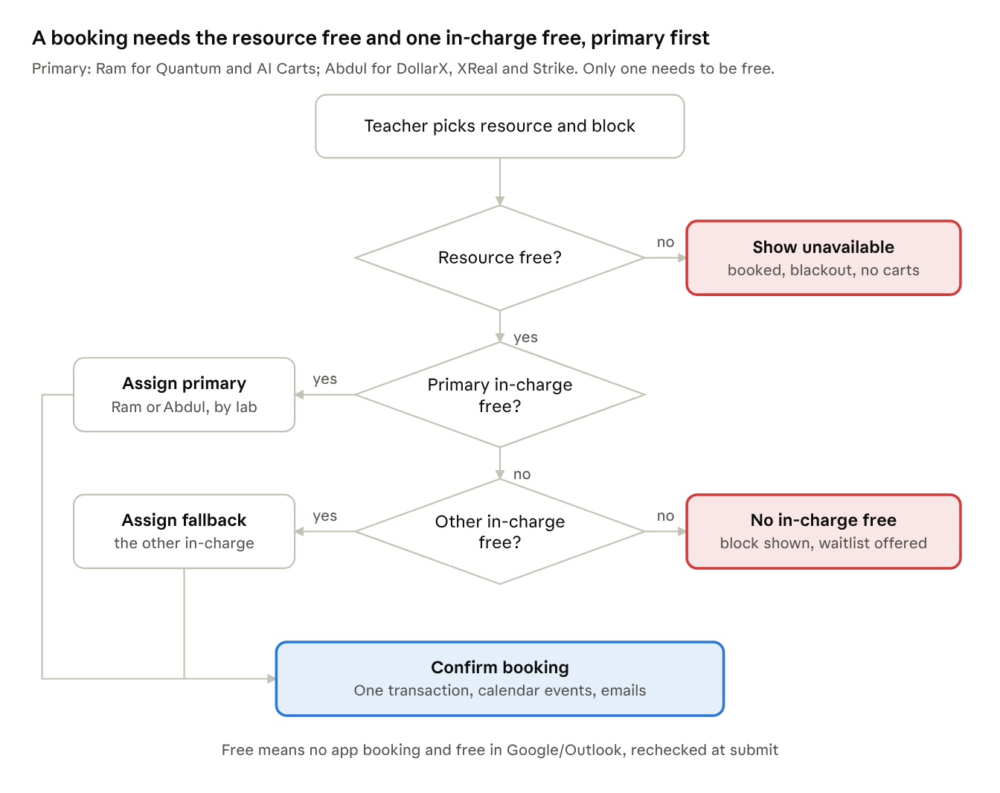

# Sunmarke Lab Booking App — Build Plan

Nov 25, 2026 · @abd

## Summary and decisions needed

Build a web booking app (installable as a PWA, later a native mobile
app) that lets Sunmarke teachers book four labs (Quantum, DollarX,
XReal, Strike) and 10 AI Carts. A booking succeeds when the resource is
free and one lab in-charge is free: the primary (Ram for Quantum and AI
Carts, Abdul for DollarX, XReal and Strike), or the other one if the
primary is busy. Free/busy is read live from the in-charge's Google or
Outlook calendar. The event is then written back to it, with
confirmation emails sent automatically. Estimated build: 2 weeks (10
school days) to a live pilot, then 2 more weeks for the Release 1.1
features. Opus 5.5 plans and reviews in Claude Code; Sonnet builds.

**One constraint shapes everything:** every booking needs Ram or Abdul
present, so the whole system can host **at most 2 sessions per block**,
whatever the number of labs or carts. The other 8 carts sit idle in any
block unless one in-charge can cover several carts, or more staff are
added.

### Decisions needed before Day 1

| \#  | Question                                                                                            | Why it matters                                       | Proposed default                                                        |
|-----|-----------------------------------------------------------------------------------------------------|------------------------------------------------------|-------------------------------------------------------------------------|
| D1  | Blocks are listed as "40 mins" but the times given are 55 minutes (e.g. 7:50–8:45). Which is right? | Slot grid and calendar events                        | Use the listed times; keep blocks configurable                          |
| D2  | Does Friday (or Ramadan) run a shorter timetable?                                                   | Most UAE schools do                                  | Support multiple named timetables by date range                         |
| D3  | Is Fortes on Google Workspace, Microsoft 365, or both?                                              | Decides the calendar and SSO integration built first | Google first (Fortes labs site is on Google), Outlook adapter second    |
| D4  | Can one AI Cart booking take several carts to one class?                                            | Cart inventory logic                                 | Yes: 1–10 carts per booking, one in-charge                              |
| D5  | Can an in-charge supervise two cart classrooms in the same block?                                   | Raises the 2-session ceiling                         | No                                                                      |
| D6  | Booking window and cut-off                                                                          | Fairness and in-charge prep time                     | Up to 4 weeks ahead; no later than 24 h before; cancel up to 2 h before |
| D7  | Who approves? Auto-confirm or in-charge approval?                                                   | Speed vs control                                     | Auto-confirm; in-charge can decline with reason                         |
| D8  | Teacher list source and sign-in                                                                     | Auto-fill and security                               | School SSO; staff CSV you provide seeds name, email, department         |
| D9  | Hosting and data location                                                                           | UAE PDPL and school IT policy                        | Confirm with Fortes IT; EU or UAE region                                |
| D10 | Brand colours, logo and font                                                                        | UI tokens                                            | Sunmarke brand assets from marketing                                    |

## Users and roles

Four roles, enforced server-side by role-based access control. Sign-in
is through school SSO only, so no teacher can book in someone else's
name.

| Role              | Who                                       | Can do                                                                                                                               |
|-------------------|-------------------------------------------|--------------------------------------------------------------------------------------------------------------------------------------|
| Teacher           | All teaching staff                        | Book, edit, cancel own bookings; view availability; join waitlist; give post-session feedback                                        |
| Lab in-charge     | Ram, Abdul (more later)                   | See own schedule; accept or decline; mark attendance and no-shows; log equipment issues; block time for maintenance or training      |
| Lab admin         | Abd (Lab Operations and Learning Manager) | Everything above, plus manage labs, carts, timetables, blackout dates, staff list, rules; override or reassign bookings; all reports |
| Leadership viewer | Dr. Neil, SLT, HoDs                       | Read-only dashboards and exported reports                                                                                            |

## Business rules

These rules live in one pure, fully unit-tested module
(/lib/booking-rules). The UI, API and future mobile app all call it, and
nothing else decides availability.

### Timetable (default, Asia/Dubai, Mon–Fri)

| Block | Start | End   | Note             |
|-------|-------|-------|------------------|
| P1    | 07:50 | 08:45 | Day opens 07:45  |
| P2    | 08:45 | 09:40 |                  |
| Break | 09:40 | 09:55 | Not bookable     |
| P3    | 09:55 | 10:50 |                  |
| P4    | 10:50 | 11:45 |                  |
| P5    | 11:45 | 12:40 |                  |
| Lunch | 12:40 | 13:30 | Not bookable     |
| P6    | 13:30 | 14:25 |                  |
| P7    | 14:25 | 15:20 | Day closes 15:30 |

Blocks are stored as data, never hard-coded. An admin can add a Friday
or Ramadan timetable with its own date range (D1, D2).

### Resources

| Resource    | Type        | Units    | Where the session happens | Primary in-charge | Fallback |
|-------------|-------------|----------|---------------------------|-------------------|----------|
| Quantum Lab | Room        | 1        | In the lab                | Ram               | Abdul    |
| AI Carts    | Mobile pool | 10 carts | Teacher's classroom       | Ram               | Abdul    |
| DollarX Lab | Room        | 1        | In the lab                | Abdul             | Ram      |
| XReal Lab   | Room        | 1        | In the lab                | Abdul             | Ram      |
| Strike Lab  | Room        | 1        | In the lab                | Abdul             | Ram      |

The primary/fallback mapping is a settings table, so adding a third
in-charge or a sixth lab needs no code change.

### Booking rules

1.  **R1 Resource free.** A room is free when it has no confirmed
    booking and no blackout (holiday, exam, maintenance) in that block.
    AI Carts are free when requested carts ≤ 10 minus carts already
    booked in that block.

2.  **R2 In-charge free.** The in-charge must have no booking in this
    app *and* show free in their Google/Outlook calendar for the whole
    block. Calendar free/busy is checked live at submit time, not just
    when the grid loads.

3.  **R3 Primary first.** Assign the resource's primary in-charge if
    free.

4.  **R4 Fallback.** If the primary is busy (another booking, a cart
    class, or any calendar event), assign the other in-charge if free.
    The teacher sees who is coming before confirming.

5.  **R5 No in-charge, no booking.** If neither is free, the block shows
    as unavailable, with the reason "No lab in-charge available". The
    teacher can join the waitlist.

6.  **R6 One place at a time.** An in-charge can hold only one booking
    per block, lab or cart.

7.  **R7 No double booking under load.** Two teachers clicking the same
    slot at the same moment: exactly one wins. Enforced by a database
    unique constraint on (in-charge, date, block) and (room, date,
    block), inside a transaction.

8.  **R8 Window.** Bookable from 24 h to 4 weeks ahead; admin can
    override (D6).

9.  **R9 Re-balance on cancel.** When a booking is cancelled, the slot
    frees immediately, the waitlist is offered it, and calendars update.

10. **R10 Calendar drift.** If an in-charge adds a personal meeting that
    clashes with an existing booking, the app flags the conflict to
    admin rather than silently cancelling.

### Data collected per booking

Teacher (from SSO; email, department auto-filled from the staff list),
resource, date, block (multi-block allowed for double lessons), subject,
year group and section, number of students, number of carts (carts
only), classroom/room number (carts only), lesson objective (short
text), optional lesson plan link, special requirements (e.g.
accessibility, equipment).

## Allocation flow

booking allocation flow · 3 checks, 2 ways to be blocked

Only one in-charge needs to be free. The primary is always tried first
(Ram for Quantum and AI Carts, Abdul for DollarX, XReal and Strike); the
other covers only when the primary is busy with a cart class, another
lab or a calendar meeting.

## Feature scope by release

MVP is what goes to the pilot; anything later waits for pilot feedback.
Items marked PM are additions beyond the original brief.

### MVP (pilot, Phases 1–6)

- SSO sign-in (Google or Microsoft); auto-fill teacher details from the
  staff list

- Week grid: resources × blocks, live availability with reason shown for
  every unavailable cell

- 3-step booking: pick slot → fill class details → confirm (shows
  assigned in-charge)

- Rules engine R1–R10, double-booking protection

- Write booking into in-charge calendar; teacher gets a calendar invite
  too

- Automated emails: confirmation, change, cancellation, 24 h reminder,
  in-charge daily schedule at 07:00

- My Bookings: edit, cancel, rebook

- In-charge view: today and this week, mark attended / no-show

- Admin: labs, carts, timetables, blackout dates, staff import (CSV),
  rule settings

- Reports dashboard with CSV export

- Audit log of every create, change, cancel and override

### Release 1.1 (after pilot)

- PM: Recurring bookings (e.g. every Tuesday P3 for the term), with
  clash preview before saving

- PM: Waitlist with auto-offer when a slot frees (first come, 2 h to
  accept)

- PM: Fair-use quota per teacher or department per week, configurable

- PM: QR check-in at the lab door; auto no-show after 10 min

- PM: Post-session feedback (1-tap rating + comment) and equipment issue
  report

- PM: Equipment / maintenance log per lab and per cart, which can block
  a slot

- PM: In-charge leave and cover: mark absence, affected bookings
  auto-reassigned or teachers notified

- PM: Lesson resource links to the Labs Hub Google Site per lab

- PDF report export and scheduled weekly report email to leadership

### Release 2 (mobile and scale)

- Native iOS/Android app (Expo, same API) with push notifications

- Microsoft Teams / Google Chat notifications

- Multi-campus support for other Fortes schools

- Arabic UI with right-to-left layout

- Curriculum mapping: tag bookings to the KS3 progressive plan levels
  for coverage reports

### Out of scope

Student accounts, payments, timetable import from the MIS (review for
Release 2).

## Architecture and tech stack

API-first TypeScript monorepo: the web app ships first as an installable
PWA, and the mobile app later reuses the same API, types and rules
package.

| Layer       | Choice                                                                                                  | Why                                                           |
|-------------|---------------------------------------------------------------------------------------------------------|---------------------------------------------------------------|
| Monorepo    | pnpm + Turborepo: apps/web, apps/mobile (R2), packages/rules, packages/db, packages/ui-tokens           | Rules and types shared by web and mobile                      |
| Web app     | Next.js (App Router) + TypeScript, PWA manifest + service worker                                        | Server components, one deploy, installable on phones now      |
| API         | Next.js route handlers exposing a versioned REST API (/api/v1) with zod schemas; OpenAPI spec generated | Mobile app and integrations consume the same contract         |
| Database    | PostgreSQL (Supabase or Neon) + Drizzle ORM                                                             | Transactions and unique constraints for double-booking safety |
| Auth        | Auth.js with Google Workspace and Microsoft Entra ID providers, domain-restricted to Fortes             | No passwords stored; staff identity from SSO                  |
| Calendars   | CalendarProvider interface with GoogleCalendarAdapter and MicrosoftGraphAdapter                         | Swap or run both without touching the rules                   |
| Email       | Sent via the school's own domain (Gmail API or Graph sendMail), React Email templates, ICS attachments  | Lands in inboxes, looks official                              |
| Jobs        | Background queue (Inngest or a Postgres-backed queue) + cron                                            | Reminders, daily digests, calendar sync retries               |
| Styling     | Tailwind CSS with design tokens; Radix primitives for accessible menus, dialogs, popovers               | Accessible behaviour, fully custom look                       |
| Charts      | Visx or Recharts, styled per the dataviz skill guidelines                                               | Clean, accessible reports                                     |
| Hosting     | Vercel or Netlify (web), managed Postgres in region agreed with IT (D9)                                 | Low ops; preview deploy per pull request                      |
| Monitoring  | Sentry for errors, uptime check, structured logs                                                        | Know before teachers complain                                 |
| Testing     | Vitest (unit), Playwright (end-to-end), axe-core (accessibility), k6 (load)                             | Covers rules, flows, a11y, concurrency                        |
| Mobile (R2) | Expo (React Native) consuming /api/v1, Expo push                                                        | Shares packages/rules and types                               |

Secrets (Google service account key, Microsoft app secret) live only in
the host's encrypted environment variables, never in the repo.

## Data model

Twelve core tables. Every booking-related row carries created_at,
updated_at and created_by; nothing is hard-deleted.

| Table                | Key fields                                                                                                                                                                                                                                  |
|----------------------|---------------------------------------------------------------------------------------------------------------------------------------------------------------------------------------------------------------------------------------------|
| staff                | id, name, email, department, role (teacher / incharge / admin / viewer), active                                                                                                                                                             |
| resources            | id, name, type (room / cart_pool), units, location, capacity, colour token, active                                                                                                                                                          |
| incharge_assignments | resource_id, staff_id, priority (1 = primary, 2 = fallback)                                                                                                                                                                                 |
| timetables           | id, name (Standard, Friday, Ramadan), valid_from, valid_to, weekdays                                                                                                                                                                        |
| blocks               | timetable_id, code (P1…P7), start_time, end_time, bookable                                                                                                                                                                                  |
| blackouts            | resource_id (or all), date range, block range, reason (holiday / exam / maintenance / training)                                                                                                                                             |
| bookings             | id, resource_id, date, block_id, teacher_id, incharge_id, subject, year_group, section, student_count, cart_count, classroom, objective, status (confirmed / cancelled / completed / no_show / declined), recurrence_id, calendar_event_ids |
| booking_slots        | booking_id, incharge_id, resource_id, date, block_id — unique (incharge, date, block) and unique (room, date, block)                                                                                                                        |
| waitlist             | resource_id, date, block_id, teacher_id, position, offered_at, expires_at                                                                                                                                                                   |
| notifications        | booking_id, channel, template, recipient, sent_at, status, error                                                                                                                                                                            |
| feedback             | booking_id, rating, comment, issue_reported                                                                                                                                                                                                 |
| audit_log            | actor_id, action, entity, entity_id, before, after, at                                                                                                                                                                                      |

Subjects and year/section lists are admin-editable lookup tables so
dropdowns stay clean for reporting.

## Calendar and email automation

The app is the source of truth for bookings; the in-charge calendars are
the source of truth for their other commitments. Both are needed by
Fortes IT by Day 5, so request access on Day 0.

### Calendar integration

| Step                     | Google Workspace                                                                                    | Microsoft 365                                                                                                                                            |
|--------------------------|-----------------------------------------------------------------------------------------------------|----------------------------------------------------------------------------------------------------------------------------------------------------------|
| Access set-up (IT admin) | Service account with domain-wide delegation, scope calendar only, limited to the in-charge accounts | Entra app registration, Calendars.ReadWrite + Mail.Send application permissions, restricted by an Application Access Policy to an "Lab In-charges" group |
| Check availability       | freebusy.query for the block                                                                        | getSchedule for the block                                                                                                                                |
| Write booking            | events.insert on in-charge calendar, teacher as attendee, booking id in extended properties         | POST /users/{id}/events, teacher as attendee, booking id in an open extension                                                                            |
| Detect outside changes   | Push notifications (events.watch), renewed by a job                                                 | Graph change subscriptions, renewed by a job                                                                                                             |
| Optional                 | One shared calendar per lab, so the school can see lab use in Google Calendar                       | One room mailbox per lab                                                                                                                                 |

Reliability rules: every calendar write is idempotent (keyed by booking
id), retried with backoff by the job queue, and logged. If the calendar
write fails after retries, the booking stays confirmed in the app, and
admin gets an alert to fix it.

### Automated emails

| Trigger                              | To                                          | Content                                                                      |
|--------------------------------------|---------------------------------------------|------------------------------------------------------------------------------|
| Booking confirmed                    | Teacher, in-charge                          | Resource, date, block, class, in-charge, ICS, "Add to calendar", cancel link |
| Booking changed / reassigned         | Teacher, old and new in-charge              | What changed, why                                                            |
| Booking cancelled                    | Teacher, in-charge, next waitlisted teacher | Slot freed                                                                   |
| Reminder 24 h before                 | Teacher                                     | Session details, lab rules or cart checklist                                 |
| Daily 07:00 digest                   | Each in-charge                              | Today's sessions, cart counts, classrooms, special requirements              |
| Calendar conflict detected           | Admin, in-charge                            | Clashing event and affected booking                                          |
| Post-session (R1.1)                  | Teacher                                     | 1-tap feedback                                                               |
| Weekly report, Sunday evening (R1.1) | Admin, leadership                           | Utilisation summary + PDF                                                    |

Emails are plain, branded HTML with a text fallback, sent from a shared
address such as labs@ on the school domain, with one-click unsubscribe
for non-essential messages.

## Reports and analytics

One Reports page with filters (date range, term, resource, in-charge,
department, year group) and CSV export on every table; PDF export
follows in R1.1. Utilisation is measured against bookable blocks only,
excluding blackouts.

| Metric                        | Definition                                                        | Question it answers                                                |
|-------------------------------|-------------------------------------------------------------------|--------------------------------------------------------------------|
| Resource utilisation %        | Booked blocks ÷ bookable blocks, per resource                     | Which labs are under- or over-used?                                |
| Cart utilisation              | Cart-blocks booked ÷ (10 × bookable blocks)                       | Do we need all 10 carts?                                           |
| In-charge load                | Sessions per in-charge per day/week; % in own vs cross-cover labs | Is the workload fair; how often is cross-cover used?               |
| Demand turned away            | Attempts blocked by "no in-charge free" + waitlist joins          | Evidence for hiring a third in-charge                              |
| Peak blocks                   | Heatmap: weekday × block                                          | When to schedule maintenance and training                          |
| Subject and year coverage     | Sessions by subject, year group, section                          | Which departments and classes use the labs; equity across sections |
| Teacher adoption              | Unique teachers booking per month; repeat rate                    | Is the tool being used? Who needs training?                        |
| Cancellation and no-show rate | By teacher, department, resource                                  | Are slots being wasted?                                            |
| Lead time                     | Days between booking and session                                  | Is the 24 h / 4 week window right?                                 |
| Feedback score (R1.1)         | Average rating, issue count per resource                          | Equipment and session quality                                      |
| Curriculum coverage (R2)      | Sessions tagged to KS3 plan levels                                | Is the progressive plan being delivered?                           |

Charts follow the dataviz skill guidelines: one message per chart,
direct labels instead of legends where possible, colour-blind-safe
palette, every number traceable to its query. A read-only analytics view
in the database lets a future Power BI or Looker Studio connection reuse
the data.

## UI/UX design

The target: a teacher books a lab in under 30 seconds and 3 taps, on a
phone between lessons, without training. The look should feel like a
well-run school timetable, not a tech demo.

### Design direction

- **Metaphor:** the school timetable. Rows are blocks (P1–P7), columns
  are resources. Teachers already read this layout every day.

- **Brand:** Sunmarke colours and logo as the only accent (D10). Neutral
  warm-grey surfaces, one accent colour for actions, one muted colour
  per resource used consistently in the grid, emails and reports.

- **Type:** one workhorse sans with tabular figures for times (e.g. IBM
  Plex Sans or Source Sans 3), a clear size scale (14 / 16 / 20 / 28).
  Times always in 24 h with tabular numerals so columns align.

- **Density:** compact on desktop for admins, roomy on mobile for
  teachers (44 px minimum touch targets).

### Rules to avoid the "AI look"

- No purple-blue gradients, glass panels, glow shadows, sparkle icons or
  emoji in UI.

- No marketing hero, no "Welcome back! 👋" banners: the first screen is
  the availability grid.

- No generic card grids; use tables, lists and the timetable grid.

- Real copy written for teachers: "Book Quantum Lab, Tue P3", not
  "Unlock your learning journey".

- One icon set (e.g. Lucide or Phosphor), used sparingly and always with
  a text label.

- Restrained motion: 150–200 ms transitions only to explain state
  change; respect reduced-motion.

### Key screens

1.  **Availability grid** (home): week picker, resource filter chips,
    cells show Free / Booked by (teacher, class) / Unavailable with
    reason. Mobile shows one day at a time with swipe between days.

2.  **Booking sheet** (slide-up on mobile, side panel on desktop):
    summary of slot and assigned in-charge at top; subject, year,
    section, students, objective; for carts also cart count and
    classroom. Smart defaults from the teacher's last booking.

3.  **Confirmation**: what, when, where, who is coming; "Added to your
    calendar"; undo for 10 seconds.

4.  **My bookings**: upcoming and past, cancel or rebook in one tap.

5.  **In-charge today**: timeline of the day, next session pinned,
    attendance buttons.

6.  **Admin**: resources, timetables, blackouts, staff, rules, audit
    log.

7.  **Reports**: KPI row, utilisation heatmap, trends, tables with
    export.

### Principles applied at every stage

- Nielsen's heuristics as the review checklist: visible system status,
  prevention over error messages (unavailable cells cannot be clicked,
  reason shown), recognition over recall, undo.

- Every unavailable state explains why and offers a next step ("Abdul is
  free at P4" or "Join waitlist").

- WCAG 2.2 AA: 4.5:1 text contrast, status never by colour alone (text +
  pattern), full keyboard use, screen-reader labels on grid cells,
  visible focus.

- Empty, loading and error states designed for every screen, not left to
  defaults.

### How Claude Code uses the skills

The builder reads the guidance in frontend-design (aesthetic direction,
typography, avoiding templated defaults) and dataviz (chart form,
colour, accessibility, dashboard layout) before UI and report work. It
applies the principles, not their visual style: the Sunmarke tokens in
packages/ui-tokens always win. Phase 1 produces a short design system
page (tokens, components, states) that all later phases must use.

## Claude Code setup: Opus plans and reviews, Sonnet builds

Run the main Claude Code session on Opus 5.5 as the orchestrator (/model
opus). It writes each phase spec, then delegates to subagents defined in
.claude/agents/, each pinned to a model in its frontmatter. Sonnet
writes the code; Opus agents review, test and act as the end user.
Nothing merges until the reviewer and QA agents both pass it.

| Agent        | Model    | Role                                                                                          | Writes code?             |
|--------------|----------|-----------------------------------------------------------------------------------------------|--------------------------|
| Main session | Opus 5.5 | Project manager and planner: phase specs, task breakdown, acceptance criteria, final sign-off | No (specs and docs only) |
| builder      | Sonnet   | Implements one task at a time to the spec, with unit tests                                    | Yes                      |
| reviewer     | Opus     | Code review: correctness, rules engine, security, design system compliance                    | No; returns findings     |
| qa-tester    | Opus     | Writes and runs Playwright, a11y and load tests; files defects                                | Test code only           |
| end-user     | Opus     | Walks the app as a teacher, in-charge and admin via Playwright screenshots; reports friction  | No                       |

### Repository files to create first

CLAUDE.md (project memory, read every session):

\# Sunmarke Lab Booking  
Source of truth: docs/PLAN.md (this build plan) and
docs/phases/phase-N.md.  
  
\## Non-negotiables  
- All availability logic lives in packages/rules. Never duplicate it in
UI or API.  
- Rules R1–R10 in docs/PLAN.md are law. Any change needs a plan update
first.  
- Every booking write runs in one DB transaction with unique
constraints.  
- Timezone Asia/Dubai. Store UTC, display local, 24 h times.  
- UI uses only tokens from packages/ui-tokens. No gradients, glass,
emoji, or stock card grids.  
- Read the frontend-design and dataviz skill guidance before UI or chart
work; apply principles, not their visual style.  
- WCAG 2.2 AA on every screen.  
- No secrets in code. Use .env.local and the host's env vars.  
  
\## Workflow per task  
1. Opus (main) writes or updates the phase spec with acceptance
criteria.  
2. Delegate to builder. Builder runs pnpm lint, typecheck, test before
handing back.  
3. Delegate to reviewer. Fix every "must" finding via builder.  
4. Delegate to qa-tester, then end-user at the end of each phase.  
5. Update docs/CHANGELOG.md and tick the phase checklist.  
  
\## Commands  
pnpm dev \| pnpm test \| pnpm test:e2e \| pnpm lint \| pnpm typecheck \|
pnpm db:migrate \| pnpm db:seed

.claude/agents/builder.md:

---  
name: builder  
description: Implements one scoped task from the current phase spec. Use
for all code changes.  
model: sonnet  
tools: Read, Write, Edit, Bash, Glob, Grep  
---  
You are the builder for the Sunmarke Lab Booking app.  
Read CLAUDE.md, docs/PLAN.md and the phase spec named in your task.  
Implement only that task. Write unit tests alongside. Use existing
components and tokens.  
Before finishing, run pnpm lint, pnpm typecheck and pnpm test; all must
pass.  
Return: files changed, how to verify, anything you could not do.

.claude/agents/reviewer.md:

---  
name: reviewer  
description: Reviews the builder's changes against the spec, rules
R1-R10, security and design system. Use after every builder task.  
model: opus  
tools: Read, Glob, Grep, Bash  
---  
Review the diff (git diff main...HEAD) against the phase spec and
docs/PLAN.md.  
Check: rule correctness and edge cases, transactions and race
conditions, authz on every route,  
input validation, secret handling, accessibility, use of ui-tokens,
empty/loading/error states,  
test quality. Classify each finding must / should / nit with file and
line. Do not edit files.

.claude/agents/qa-tester.md and .claude/agents/end-user.md follow the
same pattern with model: opus: the QA agent owns tests/e2e and the rule
test matrix below; the end-user agent runs the UAT scripts and reports
what confused it, step by step, with screenshots.

### Kick-off prompt for Phase 0

Read docs/PLAN.md. Act as project manager. Produce
docs/phases/phase-0.md and phase-1.md  
with task lists, acceptance criteria and a definition of done for each
task.  
List any decision in the "Decisions needed" table that blocks Phase 1.
Do not write app code yet.

## Two-week build plan

A 2-week sprint (10 school days) to a working pilot, with Claude Code
doing the build. Each day ends in a gate. Every gate needs: reviewer
"must" findings at zero, all tests green, end-user walkthrough passed,
and your sign-off as product owner. The code is not the slow part:
Fortes IT permissions, your decisions and real teachers testing are.
Start those on Day 0.

| Day       | Opus plans and reviews                                                                                 | Sonnet builds                                                                                                                | Gate (end of day)                                                         |
|-----------|--------------------------------------------------------------------------------------------------------|------------------------------------------------------------------------------------------------------------------------------|---------------------------------------------------------------------------|
| 0 (now)   | Close decisions D1–D10; send IT the calendar and SSO permission request; write all phase specs at once | Nothing                                                                                                                      | Decisions signed off; IT request sent; staff CSV and brand assets in hand |
| 1         | Review scaffold and schema                                                                             | Monorepo, CI, DB schema + seed, SSO sign-in, roles, design tokens, base components                                           | Sign in with a Fortes account works; CI green                             |
| 2–3       | Rule spec + test matrix; review every rule                                                             | packages/rules: timetable, availability, primary/other in-charge, cart counts, window; DB unique constraints                 | All 18 rule tests pass; double-booking race test passes                   |
| 3–5       | Flow spec and copy; UX review against design rules                                                     | Availability grid (desktop + mobile day view), booking sheet, confirmation with undo, My Bookings, cancel                    | Teacher books in ≤ 3 taps; no serious accessibility issues                |
| 5–6       | Integration and failure-handling review                                                                | Google Calendar adapter (Outlook later if needed), free/busy check at submit, event write/delete, emails + ICS, 07:00 digest | Booking shows in in-charge calendar \< 60 s; calendar clash blocks a slot |
| 7         | Console specs                                                                                          | In-charge today view + attendance; admin: resources, timetables, blackouts, staff CSV import; audit log                      | Admin adds a Friday timetable without code                                |
| 8         | Metric definitions per dataviz guidance                                                                | Reports page: utilisation, in-charge load, heatmap, subject/year coverage, demand turned away, CSV export                    | Numbers match a hand-checked seed dataset                                 |
| 9         | QA and UAT run                                                                                         | Fixes; error monitoring; backups; PWA install                                                                                | UAT scripts passed by Ram, Abdul and 3 teachers                           |
| 10        | Go/no-go                                                                                               | Final fixes; production deploy                                                                                               | Live for the pilot department                                             |
| Weeks 3–4 | Prioritise from pilot data                                                                             | Recurring bookings, waitlist, QR check-in, feedback, PDF reports, Outlook adapter                                            | Open to all staff                                                         |
| Later     |                                                                                                        | Native mobile app (Expo)                                                                                                     | Per release                                                               |

### How 2 weeks is achieved

- **Parallel builders.** After Day 3 (schema and rules fixed), Opus runs
  2–3 Sonnet builders at once in separate git worktrees: teacher flow,
  calendar/email, admin/reports.

- **MVP only.** Everything in Release 1.1 moves to weeks 3–4. Only
  Google Calendar is built first, assuming Fortes is on Google (D3).

- **Mock first.** Calendar code is built against a mock adapter, so a
  late IT approval does not stop the build; real credentials are
  switched in when granted.

- **Daily review by you.** 15 minutes at the end of each day on the
  preview link, so feedback lands the next morning.

**The one thing that can break the timeline:** IT consent for calendar
access. If it is not granted by Day 6, launch with emails + calendar
invites (ICS) only, and switch on direct calendar sync when access
arrives.

### Definition of done (every task)

- [ ] Meets the acceptance criteria in its phase spec

- [ ] Unit tests written; lint, typecheck, tests pass in CI

- [ ] Reviewer: no open "must" findings

- [ ] Uses design tokens; empty, loading, error states present

- [ ] Keyboard and screen-reader checked

- [ ] CHANGELOG updated

## QA and test plan

Quality is tested at four levels: unit tests for every rule, end-to-end
tests for every user flow, accessibility scans on every screen, and a
load test for double-booking. The QA agent owns this matrix and adds a
case for every bug found.

### Rule test matrix (must all pass by end of Day 3)

| ID  | Setup                                                      | Request           | Expected                                                                          |
|-----|------------------------------------------------------------|-------------------|-----------------------------------------------------------------------------------|
| T1  | Ram free, Quantum free                                     | Quantum, Tue P3   | Confirmed, Ram assigned                                                           |
| T2  | Ram on AI Cart Tue P3, Abdul free                          | Quantum, Tue P3   | Confirmed, Abdul assigned (cross-cover)                                           |
| T3  | Abdul in DollarX Tue P3, Ram free                          | XReal, Tue P3     | Confirmed, Ram assigned                                                           |
| T4  | Ram on carts, Abdul in Strike, Tue P3                      | Quantum, Tue P3   | Blocked: "No lab in-charge available"; waitlist offered                           |
| T5  | Quantum + DollarX booked Tue P3                            | AI Cart, Tue P3   | Blocked (both in-charges busy) though 10 carts free                               |
| T6  | Ram has an Outlook/Google meeting Tue P3                   | AI Cart, Tue P3   | Abdul assigned if free, else blocked                                              |
| T7  | 7 carts booked Tue P3 (with Ram)                           | 4 carts, Tue P3   | Blocked: only 3 carts left, and Abdul must be free for a second cart class        |
| T8  | Two teachers submit Quantum Tue P3 within 50 ms            | Both              | Exactly one confirmed, other sees "Just taken" with alternatives                  |
| T9  | Booking exists                                             | Teacher cancels   | Slot free, calendar event deleted, waitlist offered, emails sent                  |
| T10 | Ram adds a clashing meeting after booking                  | Sync job runs     | Conflict flagged to admin; booking unchanged                                      |
| T11 | Blackout on XReal Wed (maintenance)                        | XReal, Wed P2     | Blocked with reason "Maintenance"                                                 |
| T12 | Friday timetable active                                    | View Friday       | Only Friday blocks shown                                                          |
| T13 | Request 23 h ahead / 5 weeks ahead                         | Any               | Blocked by window; admin override works                                           |
| T14 | Double lesson P3+P4                                        | Quantum           | Both blocks need the same in-charge free, or reject with clear reason             |
| T15 | Teacher not in staff list                                  | Sign in           | Access denied with contact for admin                                              |
| T16 | Teacher tries another teacher's booking via API            | Cancel            | 403 Forbidden, logged                                                             |
| T17 | Calendar API down                                          | Book              | Booking stored, calendar write queued and retried; admin alerted after 3 failures |
| T18 | Booking at block boundary (P2 ends 09:40, P3 starts 09:55) | Adjacent bookings | No false overlap                                                                  |

### Other checks

- **End-to-end (Playwright):** sign in, book, edit, cancel, waitlist,
  in-charge attendance, admin timetable change, report export, on
  desktop and mobile viewports.

- **Accessibility:** axe-core on every page in CI; manual keyboard-only
  and screen-reader pass each phase.

- **Security:** authz test per API route; input validation fuzzing;
  dependency audit; no secrets in repo (gitleaks).

- **Performance:** k6 load test, 50 virtual teachers booking at once on
  Sunday evening.

- **Visual regression:** Playwright screenshots of key screens compared
  each PR, to stop design drift.

- **Defect triage:** Sev 1 (wrong booking, data loss) blocks the gate;
  Sev 2 fixed before pilot; Sev 3 goes to backlog.

## End-user UAT scripts

The end-user agent runs these on Day 9, then real staff repeat them in
the pilot. Each passes when the person finishes without help and rates
it 4/5 or higher for ease.

| Persona                            | Device                 | Task                                                       | Pass when                                                      |
|------------------------------------|------------------------|------------------------------------------------------------|----------------------------------------------------------------|
| Year 8 Science teacher, first time | Phone, between lessons | Book Quantum Lab next Tuesday P3 for 8B, 24 students       | Done in ≤ 30 s; sees Ram is coming; invite in calendar         |
| Year 5 class teacher               | Laptop                 | Book 4 AI Carts to Room 2.14, Thursday P6                  | Cart count and classroom captured; in-charge named             |
| Teacher who finds a slot taken     | Phone                  | Try XReal Wed P2 (booked)                                  | Understands why, picks suggested alternative or joins waitlist |
| Teacher whose plans changed        | Phone                  | Cancel tomorrow's booking                                  | Cancelled in 2 taps; gets email; calendar cleared              |
| Ram (in-charge)                    | Phone, 07:15           | Check today's sessions; mark 8B attended                   | Daily email received; attendance saved                         |
| Abdul (in-charge)                  | Laptop                 | Block Strike Lab Friday P1–P2 for maintenance              | Slots show "Maintenance" to teachers                           |
| Admin (Abd)                        | Laptop                 | Add Ramadan timetable; import 20 new staff from CSV        | No developer needed; errors in CSV shown per row               |
| Dr. Neil (leadership)              | Laptop                 | Find last month's lab utilisation by department and export | Answer found in \< 1 minute; CSV opens in Excel                |

## Risks and mitigations

| Risk                                                     | Impact                           | Likelihood | Mitigation                                                                                       | Owner          |
|----------------------------------------------------------|----------------------------------|------------|--------------------------------------------------------------------------------------------------|----------------|
| Fortes IT slow to grant calendar/SSO permissions         | Calendar sync delayed            | High       | Request on Day 0; build against a mock adapter; launch with ICS invites if access is late        | Abd            |
| Only 2 in-charges cap the school at 2 sessions per block | Teachers turned away; carts idle | High       | Track "demand turned away" from day 1 as evidence for a third in-charge or trained cart monitors | Abd / Dr. Neil |
| In-charges keep calendars inaccurate                     | False availability               | Medium     | Daily digest; conflict alerts; in-charge self-blocking in the app                                | Ram, Abdul     |
| Low teacher adoption (WhatsApp/email habits)             | Data incomplete                  | Medium     | SSO one-click; launch briefing; stop accepting bookings outside the app after pilot              | Abd            |
| Timetable variations (Friday, Ramadan, exams)            | Wrong slots                      | Medium     | Timetables as data with date ranges; admin UI                                                    | Abd            |
| Staff data privacy (UAE PDPL, school policy)             | Compliance                       | Low        | Store only work email, name, department; region agreed with IT; data retention policy            | Fortes IT      |
| AI-built code quality drift                              | Bugs, inconsistent UI            | Medium     | Opus review on every task; visual regression; rules package isolated with 95% coverage           | Opus reviewer  |
| Key-person dependency on Abd                             | Stalled support                  | Medium     | Admin runbook and second admin account                                                           | Abd            |

## Rollout and success metrics

Pilot with one department for two weeks, fix, then open to all staff
with a 10-minute briefing and a one-page guide. Success is judged at the
end of the first full term.

| Metric                                             | Target by end of first term |
|----------------------------------------------------|-----------------------------|
| Bookings made through the app (vs. other channels) | ≥ 95%                       |
| Teachers who have booked at least once             | ≥ 60% of teaching staff     |
| Median time to complete a booking                  | ≤ 30 s                      |
| Double bookings                                    | 0                           |
| Calendar sync success                              | ≥ 99.5%                     |
| No-show rate                                       | ≤ 5%                        |
| Teacher ease rating                                | ≥ 4.2 / 5                   |
| Lab utilisation reported to leadership             | Monthly, automated          |

### Launch checklist

- [ ] Staff CSV imported and verified

- [ ] Calendar and email permissions live in production

- [ ] Timetables and term blackouts entered

- [ ] Ram and Abdul trained on the in-charge view

- [ ] Teacher guide and short screen recording shared

- [ ] Support channel and admin runbook ready

- [ ] Backups and error alerts confirmed
