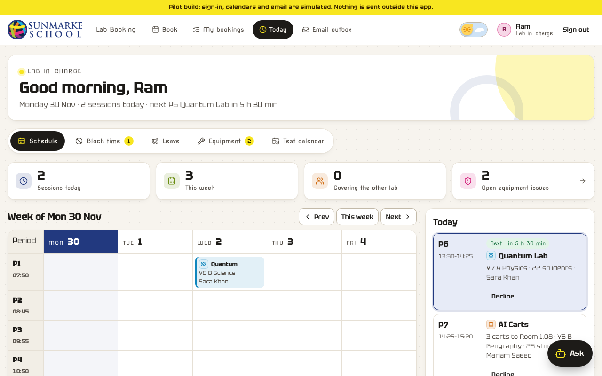

# Lab in-charge guide

Ram looks after Quantum and the AI Carts; Abdul looks after DollarX, XReal and Strike; Nael is the third in-charge for every lab. When the first choice is away or busy, a booking goes to the next one automatically.

**AI Carts:** each cart goes out with its own in-charge, so a class can book at most 3 carts. When 3 carts are out, all three of you are busy and no lab can be booked that period.

## Your screen
**Today** in the top bar opens on your **Schedule**: a calendar of your sessions. The tabs are:
- **Schedule**: today and the coming days. For each session: teacher, class, students, carts and classroom.
- **Block time**: take a lab out of use for some periods or days (maintenance, an event). Existing bookings in that time are flagged and the teachers told in Teams.
- **Leave**: record when you are away. Your bookings move to the backup in-charge; anything that cannot be covered is flagged for the admin.
- **Equipment**: open equipment problems for your labs. Report one, optionally taking the lab out of use, and **Mark fixed** when done.
- **Test calendar**: check what the booking system sees in your calendar (simulated until Fortes IT connects Google and Microsoft calendars).

## During a session
Mark **Attended** or **No-show** once it has started. Teachers can also check in with the door QR code, which marks attendance for you. A session nobody checks in to, or marks, within 10 minutes may be marked a no-show automatically.

## Declining a booking
Use **Decline** only when the lab really cannot run the lesson. Give a reason: the teacher sees it in their Teams message and in My bookings.

## Phone app
The **Sessions** tab shows today and tomorrow with the attendance buttons. Notifications tell you about new and cancelled bookings in your labs.

## Teams messages
Booking news comes to you as a Teams message. Every message the system sends is also on the **Messages** page (top bar). Until the school's Teams workflow is connected, that page is the only place they appear.
