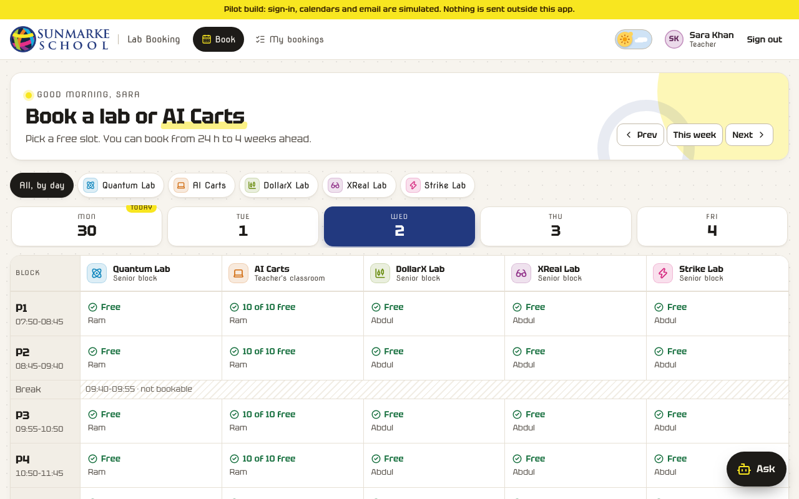
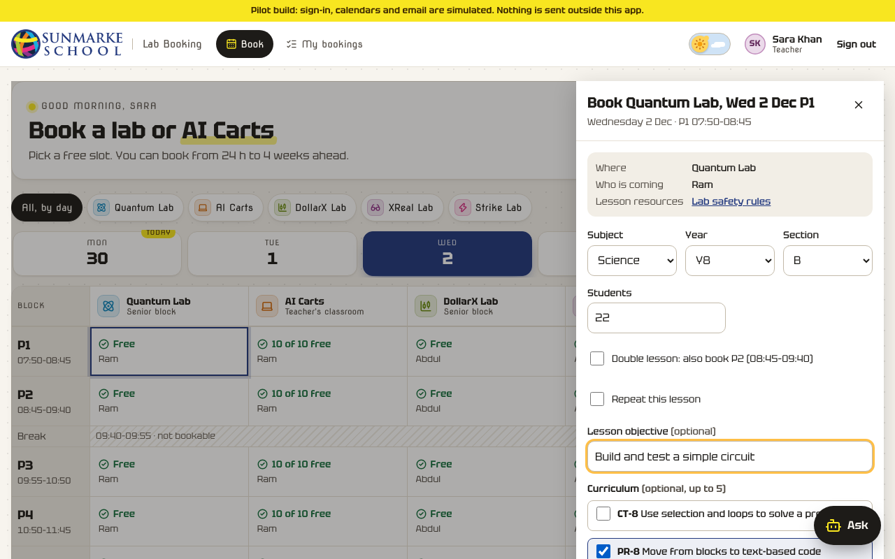

# Teacher guide

Book Sunmarke's labs (Quantum, DollarX, XReal, Strike) and the AI Carts from the website or the phone app.

## Book a lab
1. Sign in with your school email.
2. The home page shows the week. Each period × lab cell says **Free**, **Booked**, **Your booking**, or why it cannot be booked. Use the day buttons, or **Previous week** / **Next week**.
3. Pick a **Free** cell. The booking sheet opens.
4. Choose the subject (pick **Other** and type it if it is not listed), year, section and number of students. For AI Carts, say how many carts (up to 3: each comes with its own lab in-charge) and which classroom they go to.
5. Optional: lesson objective, lesson plan link, special requirements, and the curriculum levels the lesson covers.
6. Press **Book**. You get a Teams message confirming it, and your lab in-charge is told.

Each booking is one period; for two periods, book each one. Ticking **Repeat this lesson** books the same slot every week (or every 2 to 4 weeks) until a date you choose; you see every date before anything is booked.

## When a slot is not free
The cell tells you why: already booked, the in-charge is away or teaching, a blackout day, too soon or too far ahead. The sheet suggests free slots nearby; press **Book this** on one. If someone else holds the slot you can join the **waitlist**: if it frees up you get a Teams message and the slot is held for you for 2 hours.

## Rules to know
- Book at least 24 hours ahead and up to 28 days ahead.
- Cancel up to 2 hours before the lesson in **My bookings**. Closer than that, contact the in-charge.
- To change the time, cancel and rebook. You can edit the class details any time.
- Check in when you arrive: scan the QR code on the lab door (phone camera or the app). Check-in opens 15 minutes before the start. If nobody checks in or is marked present, the session may be marked a no-show.

## After the lesson
**My bookings** asks you to rate the session (1 to 5). If something was broken, say what and which item: it goes straight to the lab team's equipment log.

## Phone app
The app has the same booking grid, **Mine** for your bookings, and **Check in** with the camera. It sends a notification when a booking is confirmed, changed or cancelled (once the school switches notifications on).

## The assistant
The chat button at the bottom right can find and draft a booking for you ("Quantum on Tuesday P3 for 8B Science, 24 students"). It never books on its own: you confirm every booking.

## Help
- Lesson ideas and guides: **Labs Hub** link at the foot of every page.
- Problems with a booking: your lab in-charge (named on every booking).
